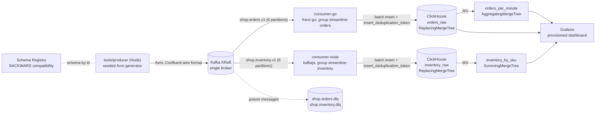

# Streamline

[](https://github.com/iboondk/streamline/actions/workflows/ci.yml)

_The badge shows live status once this repository has run CI on GitHub. Until the first run it may show no status._

Streamline is a Kafka pipeline for a Shopify-style shop. Order and inventory events are Avro-encoded through Schema Registry, consumed by a Go service and a Node service, written idempotently to ClickHouse, rolled up by materialized views, and shown in a provisioned Grafana dashboard.

The point of the project is the delivery story: Kafka gives at-least-once delivery, and the pipeline turns that into effectively-once results through three idempotent layers. See [docs/ADR-0002](docs/ADR-0002-effectively-once-with-three-dedupe-layers.md) and [docs/FAILURE_HANDLING.md](docs/FAILURE_HANDLING.md).

## Architecture



`tools/measure` samples consumer-group lag and ClickHouse row growth and writes the readings to `results/`. `scripts/replay-demo.sh` resets the orders group to the earliest offset and checks that the deduplicated counts do not change.

## Quick start

Requirements: Docker with Compose v2. For the tests only: Go 1.24 or newer, Node.js 20 or newer, and Python 3.

Start the whole stack with one command, then produce events:

```bash
docker compose up -d                 # stack, topics, Avro schemas, both consumers
docker compose ps                    # wait until the services show healthy
make produce ARGS="--rate 200 --duration 30"
```

Then open Grafana at http://localhost:3000 and sign in as `admin` with the Grafana password (`GRAFANA_ADMIN_PASSWORD`, default `change-me-local-only`).

Notes:

- A clean clone needs no `.env` file. Compose uses the local dummy defaults, which match `.env.example`. To change them, `cp .env.example .env` and edit the copy; a `.env` file is read if present and is ignored by git.
- The one-shot `init-topics` service creates the Kafka topics and `init-schemas` registers the Avro schemas with BACKWARD compatibility. Both exit with status 0 when they finish. The consumers start only after both have finished, so they do not crash-loop. Check them with `docker compose logs init-topics init-schemas`.
- `make bootstrap` runs the same steps by hand against a running stack. It is idempotent, so it is safe to run again.
- ClickHouse runs `sql/*.sql` on first start, which creates the tables and materialized views.
- `make up` creates `.env` from the example if it is missing, then runs `docker compose up -d`.
- `make replay` needs the stack running. It defaults to the `.env.example` ClickHouse credentials, so it works on a clean clone.
- `make measure` needs the stack running. Its connection defaults match `.env.example`, so it works on a clean clone. The Makefile does not read `.env`; to use other values, export them in your shell first (`set -a; . ./.env; set +a`).

## Tests

The unit tests need no running infrastructure:

```bash
make install     # locked dependencies for the Go and Node packages
make check       # static checks: JSON, YAML, Avro fields, SQL table names, shell syntax
make test        # Go and Node unit tests
```

Test counts from the last local run: consumer-go 18 (Go test functions across six packages), consumer-node 20, tools/producer 11, tools/measure 15. Results are for the unit tests only.

CI (`.github/workflows/ci.yml`) runs `make check` and `make test` on every push and pull request to `main`. In CI, `make check` fails if PyYAML is missing, so the YAML files (`docker-compose.yml` and the Grafana provisioning) are always checked. A second job runs `docker compose config` on a clean clone with no `.env`, the same path a user takes. `make check` also fails if a consumer's compose `environment` does not set an env var its code requires or uses for credentials. CI does not start the stack.

## Configuration

All settings are environment variables, documented in `.env.example` with local dummy values. Do not commit a real `.env`.

| Variable | Used by | Purpose |
|---|---|---|
| `KAFKA_BROKERS` | all | Broker list |
| `SCHEMA_REGISTRY_URL` | all | Registry URL |
| `CLICKHOUSE_URL`, `CLICKHOUSE_ADDR` | Node and Go consumers | HTTP and native endpoints |
| `CLICKHOUSE_USER`, `CLICKHOUSE_PASSWORD`, `CLICKHOUSE_DB` | consumers, measure, Grafana | ClickHouse access |
| `ORDERS_TOPIC`, `INVENTORY_TOPIC` | producer, consumers | Topic names |
| `GRAFANA_ADMIN_PASSWORD` | Grafana | Admin login |
| `BATCH_MAX` | consumer-go | Optional batch size (default 1000) |

## Status and what has been verified

- **Ran here:** `make check`, `make test`, and `go test` (18 test functions), all passing.
- **Not run here:** Docker is not installed on the authoring machine. The stack, the image builds, the `init-topics` and `init-schemas` services, `make bootstrap`, `make produce`, `make measure` and `make replay` have not been run against live services. The dashboard and ClickHouse DDL have only been checked statically.
- **No performance numbers are published.** Throughput and lag figures come only from `make measure` on a live stack and are written to `results/`.

## Documentation

- [docs/ARCHITECTURE.md](docs/ARCHITECTURE.md): components, delivery semantics and data contracts
- [DEMO.md](DEMO.md): script for recording a GIF or walkthrough
- [WRITEUP.md](WRITEUP.md): problem, architecture, decisions, results and next steps
- [docs/FAILURE_HANDLING.md](docs/FAILURE_HANDLING.md): failure modes, recovery and known limits
- [docs/ADR-0001](docs/ADR-0001-avro-with-schema-registry.md) to [docs/ADR-0005](docs/ADR-0005-sum-based-revenue-mv-limit.md): key decisions

## Repository layout

```
consumer-go/        Go orders consumer (franz-go, hamba/avro, clickhouse-go)
consumer-node/      Node inventory consumer (kafkajs, ClickHouse client)
tools/producer/     Seeded Avro event producer (CLI)
tools/measure/      Lag and row-growth sampler (writes results/)
schemas/            Avro schemas for order and inventory events
sql/                ClickHouse tables and materialized views
scripts/            Topic and schema bootstrap, replay proof, static checks
grafana/            Provisioned datasource and dashboard
docs/               Failure handling and architecture decision records
.github/workflows/  CI
```

## License

MIT. See [LICENSE](LICENSE). Author: iboondk.
